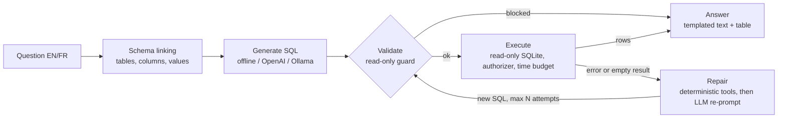

# text2sql-agent-eval

[](https://github.com/Amenflh/text2sql-agent-eval/actions/workflows/ci.yml)

A self-correcting Text-to-SQL agent for banking questions (English and French), with SQL guardrails and a
reproducible benchmark that scores answers by **executing** them. It runs and is evaluated with **no API
key**: the default backend is a deterministic offline generator. OpenAI-compatible and Ollama backends are
built in and can be switched on with an environment variable.

> **All data is synthetic.** The SQLite database (branches, customers, accounts, transactions, loans:
> 5,062 rows) is generated by `python -m t2s.data` from a fixed seed. No real customer, bank or employer data
> is involved. This is an independent re-implementation, on public tooling and synthetic data, of patterns I
> used on a production multi-agent reporting platform; it contains no code, schema or data from any employer.

## The problem

Business users ask questions such as *"Nombre de crédits en retard par région"* or *"Top 5 customers by total
balance"*. A Text-to-SQL system has to find the right tables, write valid SQL, **never modify data**, and
recover when the first draft is wrong: a value typed as `sousse` while the database stores `Sousse`, an
ambiguous column after a join, a column name that does not exist. Accuracy has to be measured, not assumed.

## Architecture



| Step | Module | What it does |
|---|---|---|
| Schema linking | `t2s/schema.py` | EN/FR lexicon plus an index of real cell values: finds the tables, measures, dimensions and filter values a question refers to. LLM backends only receive the pruned DDL and value hints. |
| Generation | `t2s/backends/` | `offline` (default): a rule-based semantic parser that renders SQL along the foreign-key tree (joins, `IN` sub-queries, `HAVING`, dates, top-N). `openai` / `ollama`: chat-completion prompts over HTTP, standard library only. |
| Validation | `t2s/guard.py` | One statement, `SELECT`/`WITH` only, no write or admin keyword (ignoring strings and comments), `LIMIT` added when missing. |
| Execution | `t2s/db.py` | Database opened with `mode=ro`, plus a SQLite authorizer that denies everything except reads, plus a time budget. Three independent layers. |
| Repair | `t2s/repair.py`, `t2s/agent.py` | Driven by the SQLite error or an empty result: qualify ambiguous columns, map unknown columns and tables, link literals to existing values (case, accents, typos). If no rule applies, the backend is re-prompted with the error. |
| Answer | `t2s/answer.py` | Templated from the rows, in the question's language, so the numbers in the text are exactly the numbers SQLite returned. |

The agent is an explicit graph of steps (`t2s/agent.py`): each node updates a shared state and returns the
next node, like a LangGraph `StateGraph` but with no dependency. Every run keeps a full trace.

The offline generator writes its first draft the way a hurried person or an LLM often does: values copied as
typed, unqualified columns, the generic word "amount" mapped to a column called `amount`. Those drafts fail in
realistic ways, and the correction loop has to fix them using only what the database returns.

## Quick start

```bash
pip install -e ".[dev]"          # the agent itself needs only the standard library
python -m t2s.data               # build the synthetic database (data/bank.db)
python -m t2s.ask "Nombre de crédits en retard par région"
python -m t2s.ask "How many customers live in sousse?" --trace
python -m t2s.eval               # benchmark -> reports/eval.md
pytest
```

HTTP API and Docker:

```bash
uvicorn t2s.api:app --port 8000          # POST /ask {"question": "..."}, GET /health
docker build -t text2sql-agent-eval . && docker run -p 8000:8000 text2sql-agent-eval
```

LLM backends (optional, not needed for the tests or the benchmark):

```bash
T2S_BACKEND=openai T2S_OPENAI_API_KEY=... T2S_MODEL=gpt-4o-mini python -m t2s.eval
T2S_BACKEND=ollama T2S_MODEL=qwen2.5-coder:7b python -m t2s.eval
```

Example trace:

```text
generate  SELECT COUNT(*) AS n FROM customers WHERE city = 'sousse'
execute   attempt 1 -> COUNT = 0 on a filtered query: suspicious
repair    value linking: 'sousse' -> 'Sousse' (city)
execute   attempt 2 -> 52
```

## Results

Offline backend, max 3 attempts, from [`reports/eval.md`](reports/eval.md) (regenerate with
`python -m t2s.eval`). 96 annotated questions (54 EN, 42 FR) with reference SQL, plus 8 adversarial requests.
A prediction counts as correct when its result set equals the reference query's result (rows as a multiset,
numbers rounded to 2 decimals, column order ignored; extra columns accepted, "strict" also reported).

| | dev (72) | held-out (24) | all (96) |
|---|---|---|---|
| Execution accuracy, first attempt | 84.7 % | 75.0 % | 82.3 % |
| Execution accuracy, after self-correction | **98.6 %** | **83.3 %** | **94.8 %** |
| Strict (identical columns) | 88.9 % | 70.8 % | 84.4 % |
| Questions fixed by the correction loop | 10 | 2 | 12 |

- Guardrails: 8/8 adversarial requests blocked (deletes, drops, updates, inserts, `; DROP TABLE` injections),
  0 benign questions blocked, database file hash unchanged after the run.
- Latency (offline, laptop): p50 under 1 ms, p95 under 2 ms per question, end to end.
- The correction loop helps most on value linking (14 % to 100 % on that slice) and nested queries.

**Read these numbers with care.** The `dev` questions were written while the offline generator was being
built and it was tuned on them, so 98.6 % mostly shows that the pipeline works. The `held-out` questions were
written afterwards and never used for tuning: 83.3 % is the honest estimate for new phrasings, and the
remaining failures are listed in the report.

## Limitations

- The offline generator is a rule-based parser for one schema: it does not understand language in general.
  It misses numbers written as words ("the three biggest"), homonyms ("compte" as a verb), negation of a
  filtered sub-query ("n'ont pas de compte épargne") and phrasings outside its lexicon.
- 96 questions on one synthetic schema is a small benchmark. Results on real data (more tables, messy values,
  business vocabulary) would be lower.
- Execution match can accept a wrong query that happens to return the same rows; the reference SQL is
  written by hand and could itself contain mistakes.
- The LLM backends are implemented and unit-tested with a mocked HTTP layer, but no LLM result is reported
  here: no API key was used.
- The repair tools work on SQL text with regular expressions, not on a parsed syntax tree.

## Next steps

- Run the benchmark with an open model through Ollama and report first-attempt vs corrected accuracy.
- Parse SQL with `sqlglot` for validation and repair instead of regular expressions.
- Add a harder test suite (Spider/BIRD-style) and distilled test databases to reduce false positives.
- Ask a clarification question when linking is ambiguous instead of guessing.
- Track runs in MLflow (`T2S_MLFLOW=1` already logs metrics if MLflow is installed; by default each run is
  appended to `reports/runs.jsonl`).

## Project layout

```text
t2s/            agent graph, schema linking, guard, repair, backends, CLI (ask), API, benchmark (eval)
eval/           questions.jsonl: reference SQL per question, dev / held-out split, adversarial requests
reports/        eval.md (human-readable), eval_results.json (per question), runs.jsonl (run log)
tests/          unit and end-to-end tests (pytest)
```

## Author

Amen Allah FELAH, AI engineer, [github.com/Amenflh](https://github.com/Amenflh). MIT licence.
